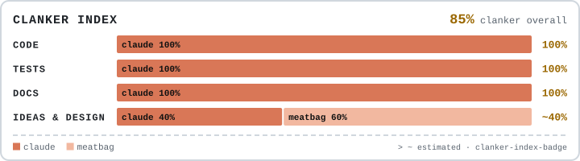

# Chatbox Studio (Rust)

<picture>
  <source media="(prefers-color-scheme: dark)" srcset=".clanker/clanker-dark.svg">
  
</picture>

A full rewrite of [Chatbox Studio](https://github.com/LuminoOwO/chatbox-studio) in Rust -
the same app (speech recognition and translation for the VRChat chatbox, music, lyrics,
clocks, PC and VR info), as one program without a Python environment.

**Status: in progress.** Nothing to download yet - use the
[Python version](https://github.com/LuminoOwO/chatbox-studio/releases) until this one is
ready.

- [`docs/INVENTORY.md`](docs/INVENTORY.md) - everything the app does, as the checklist the
  rewrite has to match, plus the architecture and the order of work.

Progress (step by step, see the inventory's order of work):

- ✅ 1. `cbs-core` - settings (reads the Python app's settings.json unchanged), paths,
  languages, routes, filters, chatbox blocks and composer, display modes; checked against
  the Python version's output
- ✅ 2. `cbs-osc` - OSC, OSCQuery, finding VRChat
- ⬜ 3. `cbs-audio` - microphone, voice detection, sentence cutting
- ⬜ 4. `cbs-asr` - Whisper and translation
- ⬜ 5. headless app
- ⬜ 6. PC / VR / music values
- ⬜ 7. the window (egui)
- ⬜ 8. setup and packages
- ⬜ 9. parity pass

Building: `cargo build --release` (Rust 1.85 or newer). Tests: `cargo test --workspace`.
